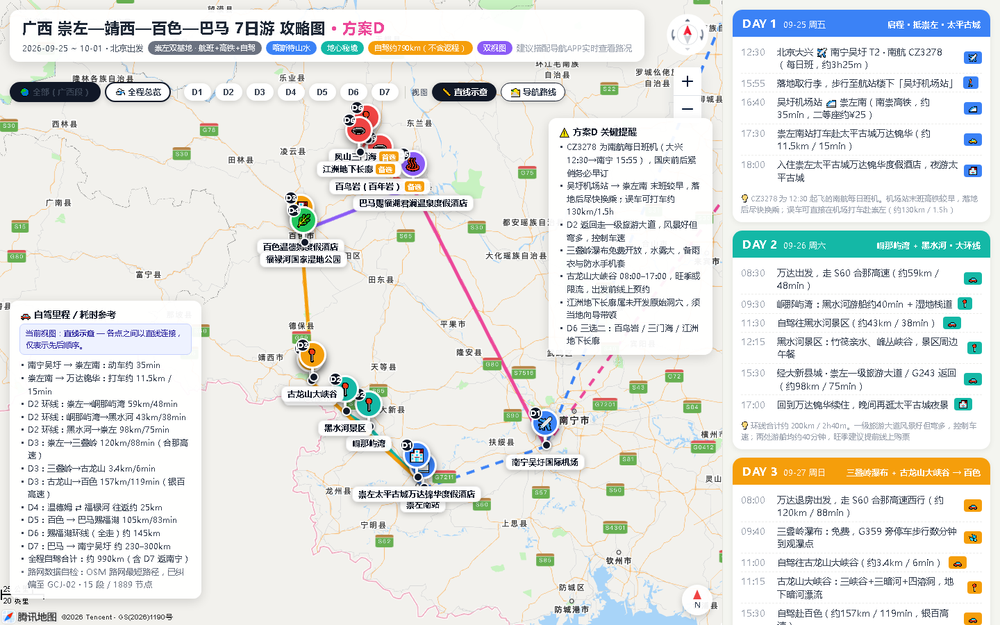

# travel-itinerary-map

**把一段旅行需求，变成一张可交互的单页行程攻略图。**

腾讯地图 + 逐日卡片 + 直线示意/真实导航双视图，一个 HTML 文件、离线可开。这是给 AI Agent 用的 **Skill**（技能包），也可以直接当模板手改。

[](LICENSE)




## 一键安装

**方式一 · 装成 Skill（推荐）**

装好后直接对 Agent 说"想去 XX 玩 N 天"，它会走完整流程：问需求 → 给路线骨架 → 拉逐日表 → 采坐标取路 → 出图 → 体检 → 交付。

```bash
# 下载并解压到 skills 目录（.skill 本质是 zip）
mkdir -p ~/.workbuddy/skills && cd ~/.workbuddy/skills
curl -L -o travel-itinerary-map.skill \
  https://github.com/ch-0204/travel-itinerary-map/releases/latest/download/travel-itinerary-map.skill
unzip -o travel-itinerary-map.skill -d .
```

> 没有 `unzip`？Windows 上把后缀改成 `.zip` 双击解压，或直接用 PowerShell 的 `Expand-Archive`。

**方式二 · 当模板用**

不装 skill，只想拿一份能改的模板：

```bash
git clone https://github.com/ch-0204/travel-itinerary-map.git
cd travel-itinerary-map
python scripts/build_trip_map.py assets/trip-data.example.json -o out.html
```

打开 `out.html` 就是一个完整的广西 7 日行程图；改 `assets/trip-data.example.json` 里的内容，重跑就换成你的行程。

---

## 它产出什么

一份 ~90KB 的单文件 HTML，包含：

| 模块 | 说明 |
|---|---|
| 左侧地图 | 腾讯地图 GL，景点按天着色打点，路段连线 |
| 右侧卡片 | 逐日时间轴，每行带时刻、地点、类型图标、跨区交通耗时 |
| 双视图 | **直线示意**（一眼看全局）/ **导航路线**（沿真实高速国道） |
| 单日筛选 | 点 D1–D7 只留当天，按 `Esc` 或再点一次回到总览 |
| 提醒面板 | 航班车次、末班船时间、山路限速这类"会翻车"的信息 |
| 里程对账 | 沿路网累加反算，和你标注的公里数偏差过大就告警 |

真实案例：[`assets/trip-data.example.json`](assets/trip-data.example.json) 是广西崇左—靖西—百色—巴马 7 日自驾的完整数据，7 天 / 17 个点 / 15 段真实路网 / 1889 个路径节点。

## 为什么不是"复制一份 HTML 改字"

内容与渲染分离：

```
trip-data.json  ──build──▶  单文件 HTML
   （纯内容）              （纯模板，无硬编码文案）
```

改行程只改 JSON 重跑，不碰 HTML。换个目的地、换天数、换配色都不用改代码。

## 快速开始

```bash
# 1. 生成页面（同时跑数据校验 + 里程对账）
python scripts/build_trip_map.py assets/trip-data.example.json -o out.html

# 2. 体检（Playwright 真点一遍：控件命中、双视图、单日筛选、Esc 回退）
node scripts/verify_page.js out.html --out=shots

# 3. 取真实路网（GCJ-02 → WGS-84 问 OSRM → 结果转回 GCJ-02）
python scripts/route_tool.py --legs legs.json --out nav.json
python scripts/route_tool.py --wgs2gcj 108.184083,22.607926   # 坐标纠偏
```

依赖：Python 3.9+ / Node 18+（`verify_page.js` 需要 `playwright`）。

## 目录

```
SKILL.md                      Agent 引导流程（对话怎么走、硬规则）
assets/template.html          渲染模板，不含任何行程内容
assets/trip-data.example.json 完整示例数据（广西 7 日）
scripts/build_trip_map.py     校验 + 注入 + 里程对账
scripts/route_tool.py         坐标转换 + OSRM 取路 + 简化
scripts/verify_page.js        Playwright 体检与截图
references/trip-data-schema.md 数据契约
references/map-gotchas.md     地图踩坑清单
evals/evals.json              3 条真实场景测试用例
```

## 三个必须知道的坑

1. **坐标必须是 GCJ-02**。给 WGS-84（GPS 原始坐标）会整体偏移约 500m。用 `route_tool.py --wgs2gcj` 转。
2. **只有驾车段配真实路网**。飞机、高铁段用直线虚线更诚实——路线本来就不是沿路走的，画成曲线是骗人。
3. **单日筛选必须有 4 条回退路径**（按钮/状态栏/Esc/再点一次）。这个页面很容易出现"点进某天就再也回不到总览"的体验坑。

更多见 [`references/map-gotchas.md`](references/map-gotchas.md)。

## 作为 Agent Skill 的流程

装好（见顶部[一键安装](#一键安装)）之后，一次完整的对话大概是这样：

```
你：想 10 月去云南玩 8 天，昆明进丽江出，带父母慢一点
 ↓ 问清：出行方式 / 节奏强度 / 必去与可舍 / 住宿偏好
 ↓ 给 2–3 个路线骨架（环线 or 单程，含里程和每日驾车时长）← 你挑一个
 ↓ 拉逐日时间表，逐条确认每一行
 ↓ 采集 POI 坐标（GCJ-02）→ 取真实路网 → 写 trip-data.json
 ↓ 出图 + 里程对账 + 体检截图
产出：一份 8 天行程图 HTML
```

## 已知限制

- 模板里的 `__WB_HTTP_PORT__` / `__WB_TMAP_SECRET__` 是预览服务注入的占位符，**直接用浏览器打开不会显示地图**。要脱离该环境使用，请在 `assets/template.html` 中把 `serviceHost` 换成你自己的腾讯地图 key（申请地址：https://lbs.qq.com/）。
- OSRM 公共实例有频率限制，批量取路请保持间隔（脚本已内置退避重试）。
- 数据仅覆盖驾车/步行为主的陆路行程，不支持轮渡、跨境。

## License

MIT
